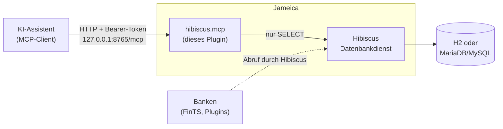

<div align="center">

# hibiscus.mcp

**Bankdaten aus Hibiscus für KI-Assistenten – als nachrüstbares Jameica-Plugin.**

Lesender MCP-Server direkt in [Jameica](https://www.willuhn.de/products/jameica/) / [Hibiscus](https://www.willuhn.de/products/hibiscus/).
Kein Zusatzdienst, keine Fremdbibliothek, Zugriff nur mit befristetem Token.


</div>

---

## In 30 Sekunden

In Jameica unter **Datei › Einstellungen › Plugins › Repositories bearbeiten** diese Adresse hinzufügen:

```text
https://raw.githubusercontent.com/ruhrgut8en/hibiscus-mcp/main/
```

Danach **hibiscus.mcp** unter „Verfügbare Plugins“ installieren, Jameica neu starten, Token ausstellen, fertig.
Die Schritte im Einzelnen stehen unter [Installation](#installation).

## Was das Plugin macht

Hibiscus holt Kontoumsätze per FinTS und über Zusatz-Plugins ab und legt sie in einer Datenbank ab.
`hibiscus.mcp` stellt diese Daten über das [Model Context Protocol](https://modelcontextprotocol.io) bereit,
sodass ein MCP-fähiger Assistent (Claude Code, Claude Desktop und andere) Fragen wie diese beantworten kann:

- „Welche Lastschriften über 100 Euro gab es im Oktober?“
- „Wie haben sich Einnahmen und Ausgaben je Monat entwickelt?“
- „Ist die Rechnung von Firma X schon bezahlt?“



Das Plugin läuft **in** Jameica und nutzt die Datenbankverbindung, die Hibiscus ohnehin offen hat.
Es funktioniert deshalb mit der eingebauten, verschlüsselten H2-Datenbank genauso wie mit MariaDB oder MySQL –
ohne eigenen Datenbankzugang und ohne dass das Datenbankpasswort irgendwo zusätzlich hinterlegt werden muss.

## Werkzeuge

| Werkzeug | Zweck | Wichtige Parameter |
|---|---|---|
| `konten` | Alle Konten mit Saldo, Saldo-Datum, Zugangsweg, Anzahl und Zeitraum der Umsätze | – |
| `umsaetze` | Umsätze suchen und auflisten, neueste zuerst | `konto_id`, `von`, `bis`, `text`, `betrag_min`, `betrag_max`, `kategorie_id`, `limit`, `offset`, `aufsteigend` |
| `umsatz` | Ein einzelner Umsatz mit allen Feldern (Referenzen, Mandat, Gläubiger-ID) | `id` |
| `auswertung` | Anzahl, Einnahmen, Ausgaben und Summe je Gruppe | `gruppierung` = `monat`, `jahr`, `kategorie`, `gegenpartei` oder `konto`, dazu die Filter von `umsaetze` |
| `kategorien` | Umsatzkategorien mit Suchmuster und Anzahl fest zugeordneter Umsätze | – |
| `protokoll` | Letzte Protokolleinträge der Bankabrufe | `konto_id`, `limit` |

Alle Filter sind optional und werden mit UND verknüpft. Die Textsuche unterscheidet keine Groß- und Kleinschreibung
und durchsucht Gegenpartei, Gegenkonto, Verwendungszweck, Buchungsart und Kommentar. Ergebnisse sind auf 1000 Zeilen
je Aufruf begrenzt; `umsaetze` lässt sich mit `offset` blättern.

## Sicherheit

| Maßnahme | Umsetzung |
|---|---|
| **Nur lesend** | Das Plugin enthält ausschließlich `SELECT`-Abfragen. Es legt keine Überweisungen an, startet keine Bankabrufe und ändert keine Daten. |
| **Nur mit befristetem Token** | Jede Anfrage braucht `Authorization: Bearer …`. Tokens gelten 1 bis 1440 Minuten. Ohne gültiges Token antwortet der Server mit `401`. |
| **Token wird nicht gespeichert** | In der Tokendatei stehen nur der SHA-256-Wert und die Ablaufzeit. Das Token selbst erscheint genau einmal bei der Ausstellung. |
| **Sofortiger Widerruf** | Die Tokendatei wird bei jeder Anfrage neu gelesen. `mcp-token widerrufen` wirkt ohne Neustart. |
| **Nur lokal erreichbar** | Standard ist `127.0.0.1`. Für den Zugriff von einem anderen Rechner ist ein SSH-Tunnel gedacht. |
| **Keine freie SQL-Abfrage** | Die Verbindung von Hibiscus hat Schreibrechte. Deshalb gibt es bewusst kein Werkzeug, das beliebiges SQL annimmt. |
| **Keine Fremdbibliotheken** | HTTP-Server und JSON kommen aus dem JDK bzw. aus dem Plugin selbst. Es wird nichts nachgeladen. |
| **Schutz vor fremden Webseiten** | Anfragen mit einem `Origin`-Kopf, der nicht auf `localhost` zeigt, werden mit `403` abgelehnt. |
| **Sparsames Protokoll** | Protokolliert werden Zeitpunkt, Werkzeugname und Bezeichnung des Tokens – keine Parameter, keine Bankdaten. |

Zwei Dinge sollte man wissen:

- Die Übertragung ist unverschlüsseltes HTTP. Das ist für `127.0.0.1` und einen SSH-Tunnel in Ordnung, **nicht** für ein offenes Netz. Wer `HIBISCUS_MCP_BIND` auf `0.0.0.0` stellt, braucht davor eine eigene Absicherung.
- Verwendungszwecke und Namen in Umsätzen stammen von Dritten. Ein Assistent sollte sie als Daten behandeln, nicht als Anweisungen; der Server weist ihn in seinen MCP-Hinweisen darauf hin.

## Installation

### 1. Plugin installieren

**Über das Repository (empfohlen)**

1. Jameica: **Datei › Einstellungen › Plugins › Repositories bearbeiten**
2. Adresse hinzufügen: `https://raw.githubusercontent.com/ruhrgut8en/hibiscus-mcp/main/`
3. Unter **Verfügbare Plugins** den Eintrag **hibiscus.mcp** installieren
4. Jameica neu starten

Das Plugin ist nicht signiert; Jameica weist bei der Installation darauf hin.

**Von Hand**

[`hibiscus.mcp.zip`](hibiscus.mcp/hibiscus.mcp.zip) herunterladen und entweder über **Datei › Einstellungen › Plugins ›
Neues Plugin installieren** auswählen oder nach `~/.jameica/plugins/` entpacken. Danach Jameica neu starten.

Ob das Plugin läuft, zeigt das Jameica-Protokoll (`jameica.log`) mit der Zeile
`hibiscus.mcp: MCP-Server auf 127.0.0.1:8765` – oder dieser Aufruf:

```bash
curl http://127.0.0.1:8765/healthz
```

### 2. Token ausstellen

Das Skript liegt im Plugin-Ordner unter `bin/mcp-token` und braucht `openssl`, `sha256sum` und `awk`:

```bash
~/.jameica/plugins/hibiscus.mcp/bin/mcp-token neu 60
```

Es gibt das Token einmal aus, hier mit 60 Minuten Gültigkeit. Weitere Befehle: `mcp-token liste` und `mcp-token widerrufen`.

### 3. Assistenten anbinden

Claude Code:

```bash
claude mcp add --transport http hibiscus http://127.0.0.1:8765/mcp --header "Authorization: Bearer DEIN_TOKEN"
```

Andere Clients: Streamable-HTTP-Endpunkt `http://127.0.0.1:8765/mcp` mit dem Kopf `Authorization: Bearer DEIN_TOKEN`.

Läuft Jameica auf einem anderen Rechner, vorher einen Tunnel öffnen:

```bash
ssh -N -L 8765:127.0.0.1:8765 benutzer@rechner
```

Nach Ablauf des Tokens ein neues ausstellen und im Client eintragen.

## Einstellungen

| Umgebungsvariable | Eintrag in der Einstellungsdatei | Standard |
|---|---|---|
| `HIBISCUS_MCP_BIND` | `bind` | `127.0.0.1` |
| `HIBISCUS_MCP_PORT` | `port` | `8765` |
| `HIBISCUS_MCP_TOKEN_FILE` | `tokenfile` | `[Jameica-Arbeitsverzeichnis]/hibiscus.mcp/tokens` |

Die Einstellungsdatei ist `cfg/net.hibiscusmcp.Plugin.properties` im Jameica-Arbeitsverzeichnis.
Umgebungsvariablen haben Vorrang. `mcp-token` liest dieselbe Variable `HIBISCUS_MCP_TOKEN_FILE`.

**In Docker** muss der Server auf allen Schnittstellen des Containers lauschen, und der Port wird nur auf dem Host selbst veröffentlicht:

```yaml
    environment:
      HIBISCUS_MCP_BIND: 0.0.0.0
      HIBISCUS_MCP_TOKEN_FILE: /config/mcp/tokens
    ports:
      - "127.0.0.1:8765:8765"
```

## Technik

- **Protokoll:** MCP über Streamable HTTP, zustandslos. Antworten kommen als JSON, es gibt keinen SSE-Strom. Unterstützte Protokollversionen: `2025-06-18`, `2025-03-26`, `2024-11-05`.
- **Datenzugriff:** über `HBCIDBService.execute(…)` von Hibiscus mit Parametern statt zusammengesetzter Zeichenketten. Die Abfragen verzichten auf datenbankspezifische Funktionen; gruppiert und summiert wird in Java.
- **Nebenläufigkeit:** ein Arbeits-Thread, weil Hibiscus eine gemeinsame Datenbankverbindung nutzt.
- **Kategorien:** Hibiscus ordnet Kategorien oft erst bei der Anzeige über Suchmuster zu. `kategorien` und `auswertung` zählen nur die fest am Umsatz gespeicherte Zuordnung.
- **Erweitern:** Ein neues Werkzeug ist eine Unterklasse von `Tools.Tool`, eingetragen in `Tools.ALL` ([`Tools.java`](plugin/src/net/hibiscusmcp/Tools.java)).

## Selbst bauen und testen

Benötigt werden JDK 17 oder neuer, `zip` und eine entpackte Jameica-Installation mit Hibiscus unter `plugins/hibiscus`.

```bash
./build.sh /pfad/zu/jameica
```

```bash
./test/run-local.sh /pfad/zu/jameica
```

Der Test startet den MCP-Server gegen eine H2-Datenbank im Speicher mit dem Schema von Hibiscus und
[erfundenen Testdaten](test/testdaten.sql) und ruft jedes Werkzeug auf, einschließlich der Fehlerfälle.

## Stand und Grenzen

Version 0.1.0 ist ein früher Stand.

- **Geprüft:** Bau gegen Jameica 2.12.0 und Hibiscus 2.12.4; Laden des Plugins in Jameica im Servermodus; alle Werkzeuge gegen H2 mit Testdaten; Token-Prüfung einschließlich Ablauf.
- **Noch nicht geprüft:** Installation über die Repository-Adresse in der Jameica-Oberfläche; Abfragen gegen MariaDB/MySQL mit echtem Datenbestand; Jameica-Versionen vor 2.12.
- **Nicht enthalten:** Schreibzugriffe jeder Art, Auslösen von Bankabrufen, Token-Ausstellung über die Jameica-Oberfläche, Signatur des Plugins.

Dieses Projekt ist kein Teil von Jameica oder Hibiscus und steht in keiner Verbindung zu deren Autor.

## Lizenz

GPL, Version 2 – siehe [LICENSE](LICENSE). Jameica und Hibiscus stehen ebenfalls unter der GPL.
